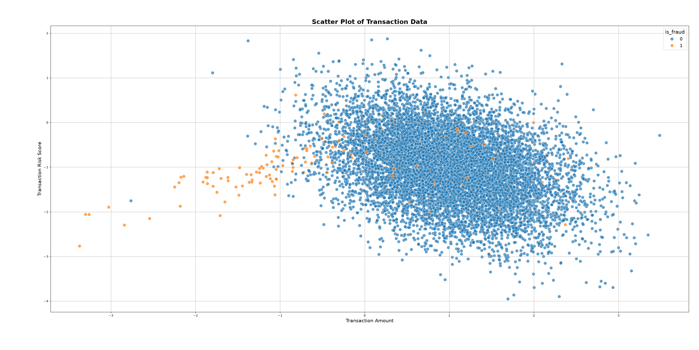

# Limits of Logistic Regression on Imbalanced Data

In this project, I attempted to train a logistic regression model on a highly imbalanced dataset using two common techniques: `class_weight` and `SMOTE`. Despite applying these methods, the model failed to achieve satisfactory performance. 

As visualized in the analysis below, the core issue is not just the class imbalance, but the non-linear, overlapping nature of the data points. This geometric overlap makes linear models like Logistic Regression fundamentally inadequate for separating the classes in this specific problem.

## 🇹🇷 Türkçe Proje Detayları ve Teknik Analiz

### 1. Problem Tanımı ve Veri Seti
Bu projede, sınıflar arası aşırı dengesizliğin (class imbalance) bulunduğu bir Kredi Kartı Dolandırıcılığı (Fraud Detection) veri setini inceledim. Veri setinde binlerce meşru işleme karşılık, yalnızca çok küçük bir oranda dolandırıcılık vakası bulunmaktaydı. Bu durum, standart makine öğrenmesi modellerinin sadece çoğunluk sınıfını tahmin ederek (accuracy paradoksu) yanıltıcı derecede yüksek başarı oranları göstermesine sebep olmaktadır.

### 2. Uygulanan Çözüm Stratejileri
Lojistik Regresyon algoritmasının bu azınlık sınıfını (dolandırıcıları) yakalayabilmesi için iki farklı literatür standardı yöntemi test ettim:
*   **Class Weight (Sınıf Ağırlıklandırma):** `class_weight_model.py` içerisinde azınlık sınıfının yanlış tahmin edilme cezasını (penalty) matematiksel olarak artırarak modelin odağını dolandırıcılık işlemlerine çekmeye çalıştım.
*   **SMOTE (Sentetik Veri Üretimi):** `smote_model.py` içerisinde veri setini `StandardScaler` ile ölçeklendirdikten sonra, azınlık sınıfı için sentetik veri noktaları üreterek sınıfları sayısal olarak eşitledim.

### 3. Geometrik Sınır ve Neden Çöktü?
Her iki yöntem uygulanmasına rağmen modelin Precision ve F1-Score metrikleri tatmin edici seviyelerin çok altında kaldı. Algoritma, şüphelendiği meşru işlemleri de dolandırıcı olarak etiketleyerek aşırı hata yapmaya başladı (False Positive patlaması). 

Bu başarısızlığın kök nedenini anlamak için verinin dağılımını görselleştirdim:

